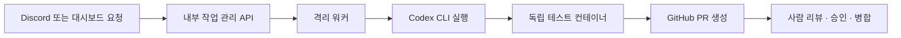

# Codex CLI 전용 빌드와 새 설치

이 프로젝트는 **ChatGPT 계정으로 로그인한 Codex CLI**로 모델 작업을 실행합니다. 모델 API 키 인증, 예산 등록·예약, 비용 추정·집계·정산은 사용하지 않습니다.

## 실행 흐름



Control API는 서비스 간 인증·작업 배정·로그·GitHub 변경을 관리합니다. 모델 추론은 워커의 `codex exec` 프로세스가 수행합니다. GitHub App·Discord Bot·내부 API의 키와 CLI 로그인 프로필은 각각 별개의 인증입니다.

워커는 고정된 Codex 0.164.0 이미지를 사용하고 요청을 표준 입력으로 전달합니다. `exec --json --ephemeral` 결과에서 완료·실패 상태와 최종 요약을 읽습니다. 사용자 설정·저장소 규칙을 자동 불러오지 않으며 ChatGPT 로그인 방식과 별도 파일 프로필을 강제합니다. CLI가 출력하는 토큰·금액 메타데이터는 작업 결과나 과금 기록으로 저장하지 않습니다.

CLI 성공과 독립 검증 명령 성공을 모두 확인한 뒤 변경 파일을 게시합니다. 사람 승인·현재 SHA·필수 CI·GitHub Rulesets 검사는 그대로 적용합니다.

## 필요한 워커 설정

먼저 개인 Linux/WSL 워커에서 전용 프로필에 로그인합니다.

```bash
pnpm codex:login
pnpm codex:status
```

| 설정                      | 의미                                                              |
| ------------------------- | ----------------------------------------------------------------- |
| `CONTROL_API_URL`         | 작업 관리 서버 주소                                               |
| `WORKER_ENROLLMENT_TOKEN` | 해당 서버와 맞춘 내부 워커 등록 토큰                              |
| `HUB_CODEX_AUTH_DIR`      | 선택: CLI 전용 프로필의 절대 경로. 기본 `.local/codex-auth`       |
| `HUB_CODEX_CLI`           | 선택: 로그인·상태 확인에 사용하는 호스트의 Codex 실행 파일        |
| `HUB_CODEX_IMAGE`         | 검증한 고정 실행 이미지의 `sha256:` ID                            |
| `HUB_RUNNER_NETWORK`      | 운영자가 Codex CLI 목적지를 제한한 `hub-egress-*` Docker 네트워크 |
| `WORKER_TEST_COMMAND`     | 운영자가 지정한 검증 명령의 JSON argv 배열                        |

```bash
pnpm runner:build
# 출력된 image ID를 HUB_CODEX_IMAGE에 반영
pnpm config:check --scope worker
pnpm runner:check
pnpm dev:worker
```

로그인 프로필은 워커 소유의 비공개 디렉터리여야 합니다. 실행기에서만 사용하고 독립 테스트 컨테이너에는 연결하지 않습니다. 프로필·키 내용을 로그·Git·공유 이미지에 저장하지 않습니다. 자세한 한도와 격리는 [Runner 보안 안내](runner-security.md)를 참고하세요.

작업은 기본 600초, 요청별 10~3,600초 제한을 사용합니다. 컨테이너에는 메모리 1 GiB·CPU 1개·PID 128·출력 한도를 적용합니다. 사용 중인 ChatGPT 계정의 Codex 사용 권한·사용 한도는 그대로 적용됩니다.

## 새 환경 설치

새 체크아웃·새 `.env`·빈 DB로 설치합니다. 기본 Compose 프로젝트는 `discord-cli-pr-hub-dev`이며 PostgreSQL은 `127.0.0.1:5433/hub_cli`, 테스트 DB는 같은 서버의 `hub_cli_test`, Redis는 `127.0.0.1:6380`을 사용합니다. 각각 새 볼륨을 사용합니다.

```bash
pnpm install --frozen-lockfile
pnpm setup:local
pnpm infra:up
pnpm db:generate
pnpm db:init
pnpm config:check
pnpm build
```

별도 터미널에서 작업 관리 서버·스케줄러·대시보드를 실행합니다.

```bash
pnpm dev
pnpm --filter @hub/orchestrator dev
pnpm --filter @hub/dashboard start
```

GitHub App·Discord Bot 설정과 저장소 등록 후, 위 CLI 로그인·격리 검사를 마친 워커를 연결합니다. [단계별 설정](integration-settings.md)에서 각 토큰·ID·파일의 사용처를 확인하세요.

## 초기 스키마와 작업 계약

초기 스키마는 CLI 작업·시도·lease·이벤트·PR·사람 승인·감사·outbox만 정의합니다. 예산·예약·비용·사용량·과거 기록 보관 테이블은 만들지 않습니다. 과거 DB의 데이터를 복사·변환하는 코드는 없습니다.

`db:init`은 빈 DB에 초기 스키마 하나를 설치합니다. 같은 CLI 스키마로 초기화한 DB에는 다시 실행할 수 있습니다. 재실행 시 초기화 이력의 이름·완료 상태와 저장된 SHA-256이 현재 초기 SQL 파일에 일치하는지 확인합니다. 다른 테이블·이력이 있는 DB는 `CLI_DATABASE_NOT_EMPTY`로 거절하며 기존 데이터를 수정하지 않습니다. 기존 DB를 지정해 덮어쓰거나 초기화하지 말고 별도의 빈 DB를 사용하세요.

작업 요청은 저장소·지시문·작업 종류·실행 제한 시간을 받습니다. 엔진은 `codex` 하나입니다. 완료·게시 결과는 `status`, `summary`, `changedPaths`, `artifacts`로 구성합니다. 작업별 금액이나 과금 내역은 계약에 없으며 엄격한 입력 검사에서 거절합니다.

Discord 명령은 `/help`, `/ping`, `/develop`, `/refactor`, `/status`, `/logs`, `/workers`, `/cancel`, `/approve`, `/merge` 10개입니다. 대시보드에서는 작업 요청·CLI 실행 제한·워커·저장소·PR·감사를 관리합니다.

새 설치 검사에서는 빈 DB 초기화, 초기화 재실행, 기존 데이터가 있는 대상의 거절, CLI 워커→검증→PR→사람 승인→병합 흐름을 확인합니다. 실제 모델 호출·외부 PR·병합은 로컬 회귀 검사에서 실행하지 않습니다.
